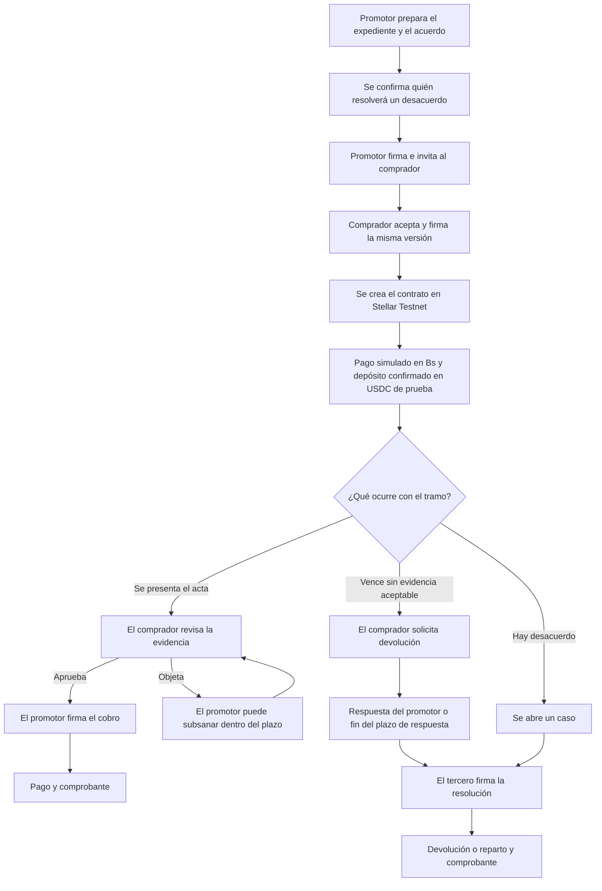
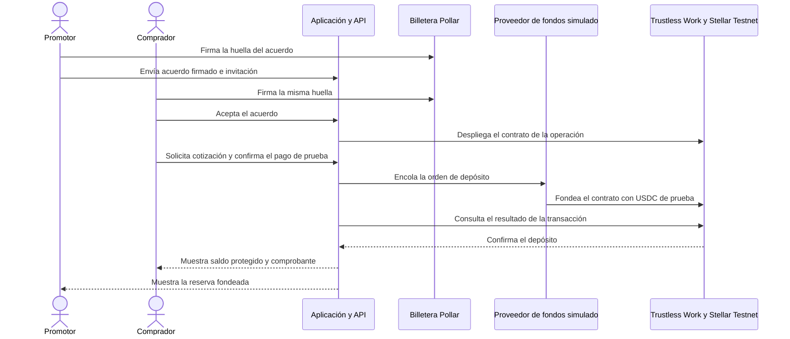
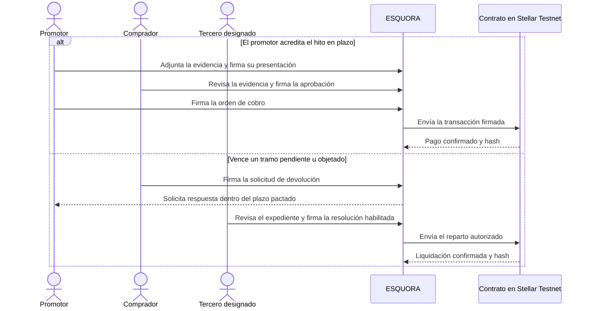
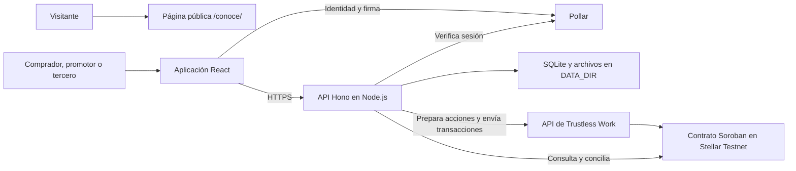
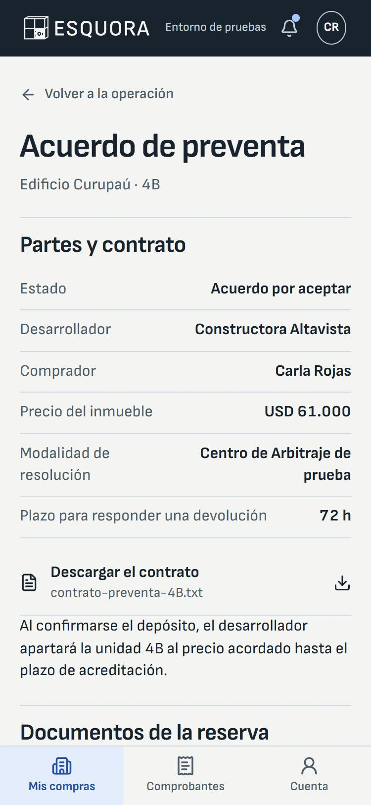
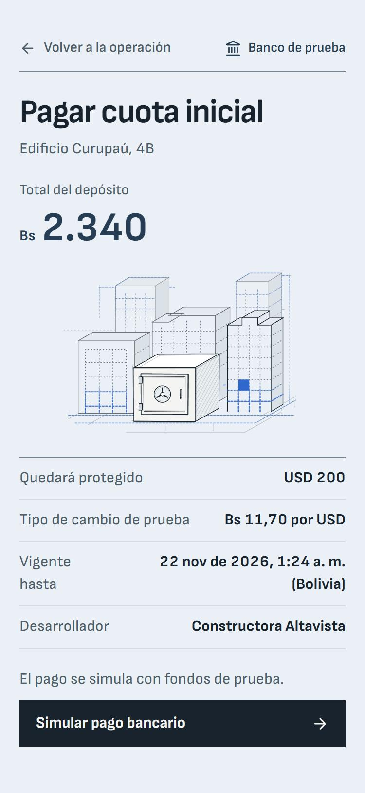
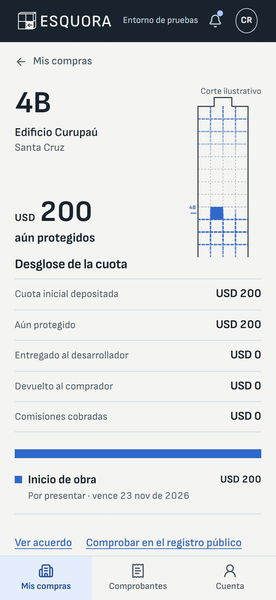
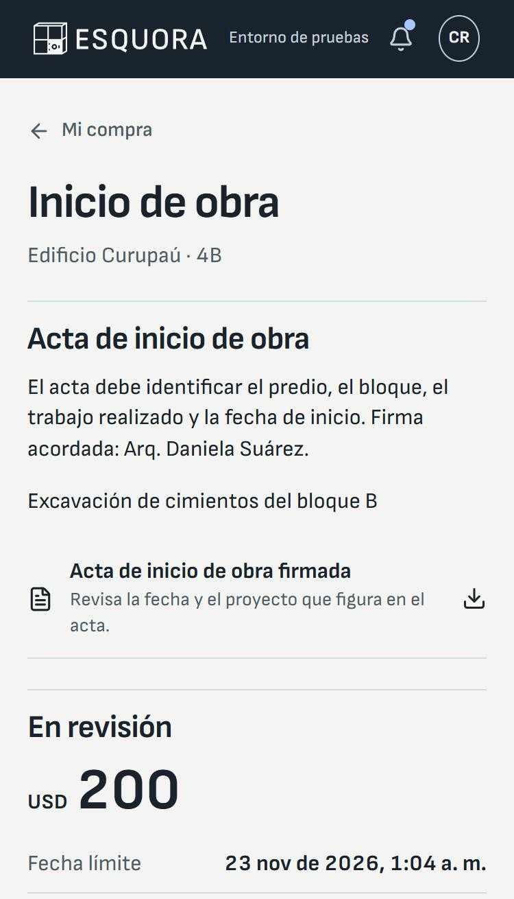
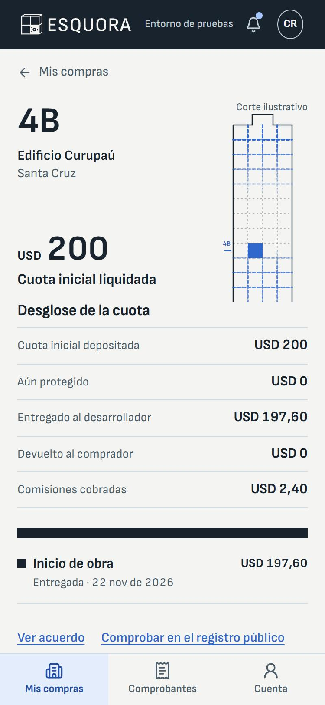
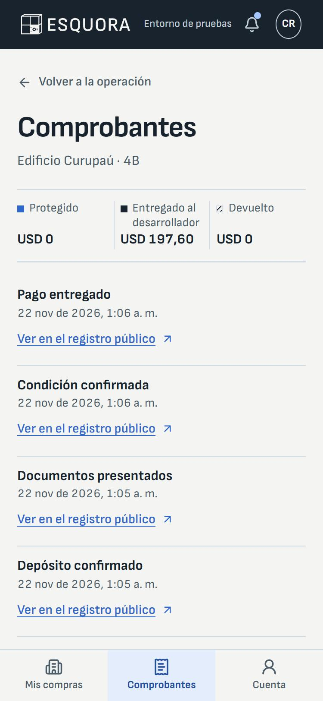

# ESQUORA

<picture>
  <source media="(prefers-color-scheme: dark)" srcset="public/esquora-logo.svg">
  
</picture>

ESQUORA permite reservar una unidad inmobiliaria en preventa y condicionar el cobro del anticipo a un avance verificable. El comprador compromete el dinero, el promotor comprueba que está depositado y ambos pueden consultar el comprobante de cada movimiento.

**Etapa: prototipo público.** La demo está desplegada y se entra con un correo y un código, sin instalar nada. El pago bancario en bolivianos y la conversión se simulan. El depósito en USDC de prueba, el cobro y la devolución se registran en **Stellar Testnet**. El contrato retiene el saldo. Las personas designadas revisan los documentos y el avance de obra.

[Conocer ESQUORA](https://esquora-production.up.railway.app/) · [Entrar a la demo](https://esquora-production.up.railway.app/entrar) · [Evidencia en Stellar Testnet](#evidencia-en-stellar-testnet) · [Recorrido verificable sin iniciar sesión](#recorrido-verificable-sin-iniciar-sesión) · [Ejecutar en local](#ejecutar-en-local)

## Qué se puede hacer

| Modalidad | Qué acuerdan las partes | Qué permite cobrar |
| --- | --- | --- |
| Reserva hasta el inicio de obra | Unidad, precio, anticipo, trabajo que acredita el inicio, profesional que firma el acta y plazo. Se incorpora el contrato certificado y la versión revisada del expediente. | El comprador aprueba el acta del bloque o unidad acordados y el promotor solicita el cobro del tramo único. |
| Acuerdo personalizado | De uno a siete tramos con importe, fecha límite y evidencia propia. El contrato adjunto es opcional. La suma de los tramos coincide con un único depósito. | Cada tramo tiene su propia aprobación y liquidación. El dinero de los demás continúa en el contrato. |

Para la reserva se revisan el registro del proveedor, la facultad de venta sobre el terreno, los planos autorizados y el permiso municipal. La aplicación conserva qué archivos se revisaron y sus huellas SHA-256. [Requisitos del expediente](shared/reservation.ts) · [Reglas de los tramos](shared/conditions.ts)

## Recorrido de una reserva

El vencimiento habilita una solicitud cuando el tramo sigue pendiente o fue objetado. La aplicación conserva el saldo hasta que se ejecute la resolución. Una operación termina cuando todos sus tramos quedan liquidados.

### Firmas y confirmación del depósito

### Cobro o devolución

El **tercero externo** acepta la invitación desde el correo designado. En la modalidad opcional **ESQUORA verifica y ejecuta**, ambas partes aceptan el mandato al firmar. La cuenta verificadora necesita una instrucción documentada con importes definidos. Una objeción anterior al envío invalida la instrucción. [Términos del mandato](shared/resolution-terms.ts) · [Implementación de las resoluciones](server/resolutions.ts)

## Arquitectura y datos

Los contratos, actas y documentos adjuntos se guardan en el servidor. SQLite conserva acuerdos, firmas, referencias de archivos, órdenes, estados y comprobantes. El contrato en la red mantiene fondos y autorizaciones. La API registra el hash de cada transacción y concilia las operaciones pendientes tras interrupciones. [Coordinación de transacciones](server/chain.ts) · [Integración con Trustless Work](server/tw.ts)

| Ubicación | Contenido |
| --- | --- |
| [conoce/](conoce/) y [src/landing/](src/landing/) | Página pública, recorrido interactivo y acceso a la demo. |
| [src/](src/) | Aplicación para los tres perfiles. [Firma con Pollar](src/signing.tsx), [pantalla de pago](src/payment.tsx) y [comprobantes](src/records.tsx). |
| [server/](server/) | [Rutas y permisos](server/app.ts), [esquema y migraciones](server/db.ts), integración con Stellar y control de acceso. |
| [shared/](shared/) | Reglas utilizadas por cliente y servidor, requisitos documentales y comisiones. |
| [public/](public/) | [Logo de la web](public/esquora-logo.svg), [favicon](public/favicon.svg), tipografía con licencia y recursos de la página pública. [Logo sobre fondo claro](diseno/marca/esquora-sobre-fondo-claro.svg). |
| [scripts/](scripts/) | Pruebas, ensayo de extremo a extremo y arranque del contenedor. [scripts/spikes/](scripts/spikes/) conserva las pruebas técnicas de la fase inicial. |
| [investigacion-esquora/](investigacion-esquora/) | Evidencia de mercado, supuestos de las estimaciones y [síntesis para el jurado](investigacion-esquora/ESQUORA-PARA-EL-JURADO.md). |

## Ejecutar en local

Se necesita Node.js **22.22 o posterior de la serie 22**, npm y credenciales de **Pollar y Trustless Work para Testnet** para recorrer la operación completa. Desde la raíz del repositorio:

1. Ejecuta `npm ci`.
2. Copia [.env.example](.env.example) a `.env` con `Copy-Item .env.example .env` en PowerShell o `cp .env.example .env` en macOS y Linux.
3. Configura `VITE_POLLAR_PUBLISHABLE_KEY`, `POLLAR_SECRET_KEY` y `TRUSTLESS_WORK_API_KEY`. Registra el origen local en Pollar para el acceso interactivo.
4. Ejecuta `npm run dev`. Abre [la aplicación](http://localhost:5173/app) o [la página pública](http://localhost:5173/). Vite atiende en el puerto 5173 y reenvía `/api` a Hono en el 8787.

Para trabajar **solo en la página pública**, usa `npm run dev:web` y abre `/conoce/`. El servidor completo prepara las cuentas de servicio en Testnet durante el arranque, por lo que necesita conexión a la red.

| Variable | Uso |
| --- | --- |
| `APP_URL`, `PORT` | Origen público de la aplicación y puerto de la API. Valores locales en [.env.example](.env.example). |
| `DATA_DIR` | Directorio persistente. Por defecto, `./data`. Contiene `esquora.db`, adjuntos y claves de servicio generadas localmente. |
| `ANCHOR_BOB_PER_USDC`, `ANCHOR_INITIAL_CENTS` | Cotización del banco simulado y reserva inicial del proveedor, en centavos de USDC de prueba. Con reserva inicial cero, el proveedor repone fondos cuando hace falta. |
| `PLATFORM_FEE_BPS` | Comisión de ESQUORA en puntos básicos. El valor predeterminado de 90 equivale al 0,9 %. |
| `ESQUORA_RESOLVER_EMAIL` | Habilita el mandato opcional con el correo de una cuenta de tercero activa, distinta de las partes y de la cuenta que percibe comisiones. |

## Pruebas y recorrido en Testnet

| Comando | Qué verifica |
| --- | --- |
| `npm run typecheck` | Comprueba los tipos de TypeScript. |
| `npm test` | Ejecuta las pruebas locales, con almacenamiento temporal. |
| `npm run build` | Compila la aplicación y la página pública en `dist/`. |
| `npm run e2e` | Recorre una operación contra Stellar Testnet. Requiere habilitación explícita. |
| `npm run e2e -- --reserva` | Ensaya el cobro y la devolución en dos reservas distintas. |

Para el ensayo de red, configura las credenciales y establece `ESQUORA_RUN_TESTNET_E2E=1` en el entorno. En PowerShell usa `$env:ESQUORA_RUN_TESTNET_E2E='1'`. Por defecto el ensayo crea su propio servidor local, directorio temporal y cuentas de prueba. Usa firmas de cuentas locales. Para verificar la experiencia de firma con Pollar, abre tres perfiles separados del navegador con correos de comprador, promotor y tercero.

## Evidencia en Stellar Testnet

El equipo completó **19 reservas de prueba de punta a punta** en Stellar Testnet. Parte de ellas se hizo desde la demo desplegada y en otros entornos, por lo que no todas constan en este repositorio. Como ejemplo, las cinco siguientes se documentan con todos sus comprobantes. Cada enlace abre el explorador público y se puede comprobar sin cuenta.

En todas, de cada importe liquidado se descuenta **0,9 % para ESQUORA** y **0,3 % para Trustless Work**. Los importes son USDC de prueba, sin valor monetario.

| Ejemplo | Fecha | Depósito | Desenlace | Contrato | Depósito | Salida |
| --- | --- | ---: | --- | --- | --- | --- |
| A. Reserva con cobro | 21 nov 2026 | 200 | Acta aprobada. El promotor cobra **197,60**. | [CBCCDLDD…](https://stellar.expert/explorer/testnet/contract/CBCCDLDD4LLBKMSFVP65B3UENLTODZU6YATVPR2DEUBIV4HLIFTALRCQ) | [depósito](https://stellar.expert/explorer/testnet/tx/9bf70b58008be568dcd6a7b5f14f5bba020f9362bbdf6b0bf93d511684689aa7) | [cobro](https://stellar.expert/explorer/testnet/tx/95fd64ec25e11e4c65b3be195fa08df4d744a03aee49ad27519bdd170c0f7b93) |
| B. Reserva con devolución | 21 nov 2026 | 200 | Vence el plazo. El comprador recupera **197,60**. | [CDEORXCZ…](https://stellar.expert/explorer/testnet/contract/CDEORXCZZSKVEEACZW7AOTCJW3RGCUZ73DPB4C3HFEJ5YHDYDHVQJT6U) | [depósito](https://stellar.expert/explorer/testnet/tx/440921cb07668e343614f40f1e35bf420f4be27b5ccd985c412c112b9a0e1fd0) | [devolución](https://stellar.expert/explorer/testnet/tx/6a77605c857e54fcd80a8f25d2025ab2ff9d4e29ce96d72a6cb74e172080e17a) |
| C. Dos tramos con tercero externo | 18 nov 2026 | 10 | Un tramo se cobra (**4,94**) y el otro se devuelve (**4,94**). | [CA43BBSD…](https://stellar.expert/explorer/testnet/contract/CA43BBSDOL5BHFSTMI5ETDZ6YTNJKGB6RYXIU3HP6U2GN5HJFNBV6ABL) | [depósito](https://stellar.expert/explorer/testnet/tx/504e13d05fc4828bca54e3a6e302da9544c357b469b9204aaa0608b4fea33d42) | [cobro](https://stellar.expert/explorer/testnet/tx/876af7010db3faf2e8cb006ae33ecac9c7944c594e2606693fb235b2f71bf52c) · [devolución](https://stellar.expert/explorer/testnet/tx/659b57bef7fb1cc2581f3db1ad19a072235034e3055fa90046c5084c9fd86827) |
| D. Cuota inicial de tamaño real | 17 nov 2026 | 12.000 | Un tramo de 6.000 se cobra (**5.928**) y el otro se devuelve (**5.928**). | [CDZFE5NS…](https://stellar.expert/explorer/testnet/contract/CDZFE5NSOTEVIPR5EC6P5ZA3XGEO2ZVXHCAYJ43LLAZGJIXDP3ACRSTR) | [depósito](https://stellar.expert/explorer/testnet/tx/da863582d07e439d3ea6792fb766e768e10244edf722de3ac78d77bb0042e401) | [cobro](https://stellar.expert/explorer/testnet/tx/d72aac3560ff22719add3009ecf93d45cd9babffa9fa05b0459f8d66bf13d2a1) · [devolución](https://stellar.expert/explorer/testnet/tx/dbda702f18d8f800470cc3356153a8d32fb62328f5a01dda1189b694501c52a2) |

| E. Reserva de las capturas | 22 nov 2026 | 200 | Acta aprobada. El promotor cobra **197,60**. | [CAAGG7FG…](https://stellar.expert/explorer/testnet/contract/CAAGG7FGOM5PJ3RQ2TNUX7ZERW4F6DTXDDQGP4JWG7IR74UN2XWYXZFD) | [depósito](https://stellar.expert/explorer/testnet/tx/2978c472ede5567b882ff3ebc6ec2faece54ad4c9aab6cb02fec2ad9ec3b39e8) | [cobro](https://stellar.expert/explorer/testnet/tx/e31bf6a654363e3d5f59bd44a6cbb7455e8f6965a6c0a1aba2664f19bbe0367e) |

**Por qué hay importes distintos.** A, B y E son la reserva de un solo tramo que muestra la demo. C usa dos tramos y un tercero externo. D es el ensayo técnico inicial, hecho con cuentas de prueba para medir las comisiones con una cuota inicial de tamaño real: de cada tramo de 6.000, el destinatario recibe 5.928, ESQUORA 54 y Trustless Work 18.

Para listar las reservas que guarda un servidor, con su importe, desenlace y hashes, ejecuta `npm run evidencia`. Lee la base del directorio `DATA_DIR` y no modifica nada.

### Recorrido verificable sin iniciar sesión

Estas pantallas son de la aplicación tal como la ve la compradora durante la reserva E. Cada una lleva la transacción que la respalda.

<table>
  <tr>
    <td width="33%"></td>
    <td width="33%"></td>
    <td width="33%"></td>
  </tr>
  <tr>
    <td><strong>1. Acuerdo y firma.</strong> La compradora revisa las partes, el precio, el contrato y quién resuelve un desacuerdo. Al aceptar se crea el contrato en la red. <a href="https://stellar.expert/explorer/testnet/tx/f1009c27883bf5d495a5451be59a82fdac73dc5fa40b69eb713f5acd610a188e">Ver transacción</a></td>
    <td><strong>2. Pago.</strong> Paga en bolivianos en un banco de prueba y ve cuánto quedará protegido. Este paso se simula y no genera transacción.</td>
    <td><strong>3. Depósito.</strong> Los 200 USDC de prueba quedan retenidos en el contrato. <a href="https://stellar.expert/explorer/testnet/tx/2978c472ede5567b882ff3ebc6ec2faece54ad4c9aab6cb02fec2ad9ec3b39e8">Ver transacción</a></td>
  </tr>
  <tr>
    <td></td>
    <td></td>
    <td></td>
  </tr>
  <tr>
    <td><strong>4. Acta.</strong> El promotor presenta el acta de inicio de obra y la compradora la revisa. <a href="https://stellar.expert/explorer/testnet/tx/f9f550355b73a5a97a0d8c71ac0de6dae3cc4e3c4ca8f34bfd15277f553b2942">Ver transacción</a></td>
    <td><strong>5. Cobro.</strong> La compradora <a href="https://stellar.expert/explorer/testnet/tx/34f60cc99905addfbf0256800ad167b5e3ba9ee1425c208606deedbb4ceddff3">aprueba</a> y el promotor <a href="https://stellar.expert/explorer/testnet/tx/e31bf6a654363e3d5f59bd44a6cbb7455e8f6965a6c0a1aba2664f19bbe0367e">cobra 197,60</a>. Las comisiones suman 2,40.</td>
    <td><strong>6. Comprobantes.</strong> Cada movimiento tiene su enlace al registro público, que se abre sin cuenta.</td>
  </tr>
</table>

Las capturas se tomaron el 22 de noviembre de 2026 con la aplicación en local, un acceso de prueba y llaves de prueba en lugar de Pollar. Se regeneran con `node scripts/capturas/servidor.mjs` y las etapas de [scripts/capturas/flujo.ts](scripts/capturas/flujo.ts).

Estos son todos los pasos de las reservas A y B. Cada uno es una transacción del contrato en Stellar Testnet.

| Paso | Quién firma | Reserva A, con cobro | Reserva B, con devolución |
| --- | --- | --- | --- |
| 1. Acuerdo firmado y contrato creado | Plataforma, con la huella del acuerdo | [ver transacción](https://stellar.expert/explorer/testnet/tx/fb83b28fce82542401aaf5d03cf720af2d669f63ccfdce075e84d34e9d0c7675) | [ver transacción](https://stellar.expert/explorer/testnet/tx/0b9388b26bc2d9d7126559373fab263d3d4c3a8a6d5367c9442c84296557498d) |
| 2. Depósito de 200 USDC de prueba | Proveedor de fondos simulado | [ver transacción](https://stellar.expert/explorer/testnet/tx/9bf70b58008be568dcd6a7b5f14f5bba020f9362bbdf6b0bf93d511684689aa7) | [ver transacción](https://stellar.expert/explorer/testnet/tx/440921cb07668e343614f40f1e35bf420f4be27b5ccd985c412c112b9a0e1fd0) |
| 3. Acta de inicio de obra presentada | Promotor | [ver transacción](https://stellar.expert/explorer/testnet/tx/a32fb0e5212b44eb83b67d5a929b6517e57895c01f679612fc0ec40c0c0b5622) | No se presenta |
| 4. Aprobación del comprador | Comprador | [ver transacción](https://stellar.expert/explorer/testnet/tx/ad5d9140ce0d18673e2ccf17ba37d968750291f47484feef61fe4a16d790e64c) | No hay aprobación |
| 5. Cobro del promotor | Promotor | [ver transacción](https://stellar.expert/explorer/testnet/tx/95fd64ec25e11e4c65b3be195fa08df4d744a03aee49ad27519bdd170c0f7b93) | No aplica |
| 6. Solicitud de devolución | Comprador | No aplica | [ver transacción](https://stellar.expert/explorer/testnet/tx/6598f1306ab92cac40d6d210ad6aef539df1e92187f614ceaeb6d2c857428a5f) |
| 7. Devolución ejecutada | Tercero designado | No aplica | [ver transacción](https://stellar.expert/explorer/testnet/tx/6a77605c857e54fcd80a8f25d2025ab2ff9d4e29ce96d72a6cb74e172080e17a) |

La firma del acuerdo por comprador y promotor se hace sobre su huella con Pollar y no genera una transacción propia. La huella queda guardada en el contrato desde el paso 1.

### Intentos rechazados por la red

En el ensayo inicial se probaron **14 intentos no autorizados y la red rechazó los 14**. Cuatro quedaron registrados como transacciones fallidas, con el saldo intacto.

| Intento | Resultado en Stellar Testnet |
| --- | --- |
| El promotor intenta cobrar sin la confirmación del comprador | [transacción fallida](https://stellar.expert/explorer/testnet/tx/80e06be2fdd92b9abb822b477492d353d4a793b970895fa338ad4e6e0eace2b8) |
| El comprador intenta retirar por su cuenta | [transacción fallida](https://stellar.expert/explorer/testnet/tx/4f9fbfc4654bc332d3e721cbbd833b674e76ae4ce9abf9c0233f3530e46946ad) |
| El comprador intenta resolver a su favor | [transacción fallida](https://stellar.expert/explorer/testnet/tx/6998e688f5a37a9d46e394ef2779ccabd5a27e5e72094ee0a50b400a7ff135e1) |
| La cuenta de la plataforma intenta retirar | [transacción fallida](https://stellar.expert/explorer/testnet/tx/d79a66bdbf9d7b6b18569fef5bd8ee37765c0bf77ab92507df2c71b67590608c) |

El detalle de las catorce pruebas de permisos está en el [plan técnico](PLAN.md#21-resultados-de-la-fase-0-17-de-noviembre).

## Despliegue y persistencia

El [Dockerfile](Dockerfile) construye ambas entradas con Vite y las sirve desde Hono. En Railway utiliza una réplica, un volumen escribible en `/app/data` y la comprobación de salud `GET /api/health`. Configura un origen HTTPS en `APP_URL` y registra ese origen y sus retornos autorizados en Pollar.

Pasa `VITE_POLLAR_PUBLISHABLE_KEY` como argumento público de compilación. Las claves secretas se proporcionan al contenedor en ejecución. La página pública se sirve en `/` y `/conoce/`. «Probar demo» abre `/entrar` directamente. Cada usuario inicia sesión con Pollar para acceder a sus operaciones en `/app`. [Sesiones y permisos](server/app.ts) · [Rutas web](server/landing.ts)

Conserva el directorio de datos completo entre despliegues. Antes de migrar una base anterior, la aplicación crea una copia de SQLite en `DATA_DIR`; los adjuntos y claves de servicio requieren su propio respaldo. Si Stellar reinicia Testnet, los expedientes locales se conservan y las operaciones de prueba deben recrearse en la nueva red.

## Mercado y modelo de ingresos

ESQUORA cobra **0,9 % del importe liquidado**. La comisión se descuenta en el cobro y en la devolución, así que la paga quien recibe el dinero: el promotor, el comprador o ambos si hay reparto. El modelo es **B2B2C**: el comprador pide la protección y el promotor la ofrece en su sala de ventas.

La cuenta del mercado, para departamentos en preventa en toda Bolivia:

| Factor | Valor | Origen |
| --- | ---: | --- |
| Compras al año con adelanto antes de la entrega | Unas 2.100 | 7.029 departamentos más cada año entre los censos 2012 y 2024, con 30 % comprados en preventa |
| Adelanto medio | USD 12.200 | 20 % de un precio mediano de USD 61.000 en 277 anuncios |
| Adelantos al año | USD 25,7 millones | 7.029 × 30 % × USD 61.000 × 20 % |
| Ingreso anual potencial, solo con la inicial | USD 230.600 | 2.100 × USD 12.200 × 0,9 % |
| Ingreso anual potencial, con toda la compra por hitos | USD 1.152.900 | 2.100 × USD 61.000 × 0,9 % |

Son estimaciones del equipo y cuentan solo departamentos. Terrenos, casas y lotes se suman aparte. [Supuestos y sensibilidad](investigacion-esquora/SINTESIS-PREVENTA-ESQUORA.md) · [Cuantificación nacional](investigacion-esquora/CUANTIFICACION-NACIONAL-ANTICIPOS.md)

**Dos cifras del problema que miden cosas distintas.** Los **USD 3,1 millones al año** son un escenario del equipo sobre adelantos de viviendas y lotes expuestos a incumplimientos, construido desde las restituciones que reporta Defensa del Consumidor. Los **USD 12 millones** son el perjuicio que una sola investigación en Santa Cruz estimó en 2025, acumulado en varios proyectos y años. La segunda no es anual ni forma parte de la primera, y no se suman. [Cálculo y fuentes](investigacion-esquora/RESERVAS-INICIALES-Y-PERJUICIO-2026-11-21.md)

## Del banco simulado a bolivianos reales

Hoy el pago en bolivianos y la conversión se simulan en una pasarela rotulada como entorno de pruebas. Lo que ya es real es el movimiento en la red: el depósito, el cobro y la devolución se liquidan en USDC de prueba sobre Stellar Testnet.

El reemplazo previsto, en orden:

1. **Entrada y salida en bolivianos con Pollar.** Pollar anuncia cobro por QR bancario en Bolivia. El comprador paga su adelanto por QR y el promotor retira a su cuenta bancaria por la misma vía. Falta confirmar con Pollar los límites por operación, el costo y quién figura como titular.
2. **USDC en la red principal.** La reserva ya usa USDC de Circle en Testnet. Trustless Work ofrece el mismo contrato en Mainnet, así que se sustituyen la red, las cuentas y las claves, no el recorrido.
3. **Dos estados separados en pantalla.** El comprobante en Stellar acredita el movimiento en la red. El abono en el banco es un paso posterior y se muestra como tal.

No encontramos en el directorio público de Stellar un anchor que opere con bolivianos. Si aparece uno, la integración estándar sería SEP-24.

**Dependencias antes de mover dinero real.**

- **Marco regulatorio.** La [Resolución de Directorio 082/2024 del BCB](https://www.bcb.gob.bo/webdocs/01_resoluciones/RD%20082%202024.pdf) habilitó los canales electrónicos de pago para activos virtuales, y el [DS 5384](https://www.asfi.gob.bo/sites/default/files/2025-08/Decreto%20Supremo%20N%C2%B0%205384%20de%20fecha%207%20de%20mayo%20de%202025.pdf) regula a las empresas de tecnología financiera. Queda por determinar el encuadre de este flujo y quién puede operar la rampa.
- **Costo de conversión.** El 0,9 % no es el costo total para el usuario. La conversión entre bolivianos y USDC se cotiza aparte.
- **Devoluciones.** Un adelanto puede volver semanas después, con otra cotización. El acuerdo debe decir quién asume esa diferencia.

## Equipo y aportes

ScaleNova, Bolivia. National Startups Hackathon by Stellar.

| Integrante | Formación | Aporte en ESQUORA |
| --- | --- | --- |
| Jorge Magne | Ingeniero de sistemas | Desarrolló la aplicación y la integración con Stellar, Trustless Work y Pollar. |
| Vladimir Chura | Ingeniero en desarrollo de software | Coordinó la dirección técnica del producto, con foco en la arquitectura, el modelo de datos y los flujos de usuario. |
| Rodrigo Beltran | Ingeniero en informática | Coordinó la dirección técnica del producto, con foco en el recorrido de punta a punta y las pruebas de calidad. |
| Gina Villanueva | Ingeniera comercial, con maestría en inteligencia artificial aplicada a las empresas | Investigó el mercado y las necesidades del comprador, y orientó la experiencia de uso para que la reserva se entienda sin tecnicismos. |
| Milka Beltran | Ingeniera comercial | Lleva el frente comercial de ESQUORA, con el modelo de ingresos, la relación con promotoras y todo lo relacionado con criptoactivos. |

El código se publicó desde una sola cuenta. La dirección técnica, las pruebas, la investigación y el frente comercial se trabajaron en equipo.

Dónde está el trabajo de cada área:

- **Producto y red.** Integración con Stellar, Trustless Work y Pollar en [server/](server/), firma en [src/signing.tsx](src/signing.tsx) y reglas compartidas en [shared/](shared/).
- **Aplicación y página pública.** Los tres perfiles en [src/](src/) y la página en [conoce/](conoce/).
- **Mercado y validación.** [Investigación](investigacion-esquora/) y [entrevistas](investigacion-esquora/ENTREVISTAS.md).
- **Presentación.** [Guion del pitch y de la demo](GUION-PITCH.md).

## Documentación del proyecto

- [Entrevistas con compradores y una promotora](investigacion-esquora/ENTREVISTAS.md). Qué se preguntó y qué respondieron.
- [Contrato de dirección](CONTRATO-DE-DIRECCION.md) y [modelo ejecutable de referencia](scripts/referencia/contrato-direccion.ts). Reglas de la reserva y escenarios de aceptación.
- [Guía visual](DESIGN.md) y [maqueta aprobada de Mi compra](diseno/maquetas/compra.html). Dirección de diseño y referencia de interfaz.
- [Definición de producto](PRODUCT.md) y [plan técnico de la fase inicial](PLAN.md). Antecedentes, experimentos y decisiones de implementación.
