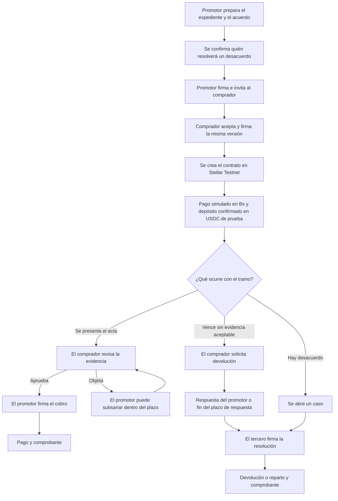
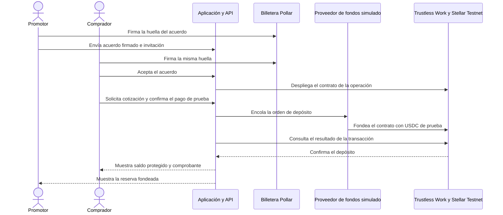
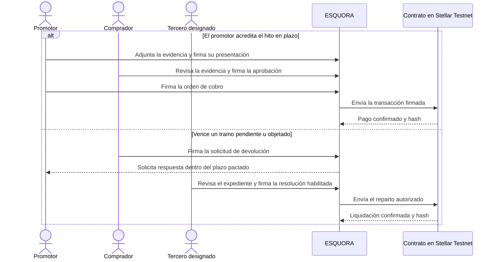
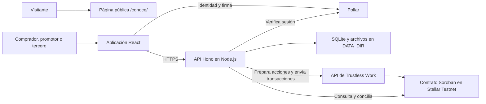

# ESQUORA

<picture>
  <source media="(prefers-color-scheme: dark)" srcset="public/esquora-logo.svg">
  
</picture>

ESQUORA permite reservar una unidad inmobiliaria en preventa y condicionar el cobro del anticipo a un avance verificable. El comprador compromete el dinero, el promotor comprueba que está depositado y ambos pueden consultar el comprobante de cada movimiento.

**Entorno del prototipo:** el pago bancario en bolivianos y la conversión se simulan. El depósito en USDC de prueba, el cobro y la devolución se registran en **Stellar Testnet**. El contrato retiene el saldo. Las personas designadas revisan los documentos y el avance de obra.

[Conocer ESQUORA](https://esquora-production.up.railway.app/) · [Entrar a la demo](https://esquora-production.up.railway.app/entrar) · [Ejecutar en local](#ejecutar-en-local) · [Comprobantes de prueba](#comprobantes-de-prueba)

## Qué se puede hacer

| Modalidad | Qué acuerdan las partes | Qué permite cobrar |
| --- | --- | --- |
| Reserva hasta el inicio de obra | Unidad, precio, anticipo, trabajo que acredita el inicio, profesional que firma el acta y plazo. Se incorpora el contrato certificado y la versión revisada del expediente. | El comprador aprueba el acta del bloque o unidad acordados y el promotor solicita el cobro del tramo único. |
| Acuerdo personalizado | De uno a siete tramos con importe, fecha límite y evidencia propia. El contrato adjunto es opcional. La suma de los tramos coincide con un único depósito. | Cada tramo tiene su propia aprobación y liquidación. El dinero de los demás continúa en el contrato. |

Para la reserva se revisan el registro del proveedor, la facultad de venta sobre el terreno, los planos autorizados y el permiso municipal. La aplicación conserva qué archivos se revisaron y sus huellas SHA-256. [Requisitos del expediente](shared/reservation.ts) · [Reglas de los tramos](shared/conditions.ts)

## Recorrido de una reserva

El vencimiento habilita una solicitud cuando el tramo sigue pendiente o fue objetado. La aplicación conserva el saldo hasta que se ejecute la resolución. Una operación termina cuando todos sus tramos quedan liquidados.

### Firmas y confirmación del depósito

### Cobro o devolución

El **tercero externo** acepta la invitación desde el correo designado. En la modalidad opcional **ESQUORA verifica y ejecuta**, ambas partes aceptan el mandato al firmar. La cuenta verificadora necesita una instrucción documentada con importes definidos. Una objeción anterior al envío invalida la instrucción. [Términos del mandato](shared/resolution-terms.ts) · [Implementación de las resoluciones](server/resolutions.ts)

## Arquitectura y datos

Los contratos, actas y documentos adjuntos se guardan en el servidor. SQLite conserva acuerdos, firmas, referencias de archivos, órdenes, estados y comprobantes. El contrato en la red mantiene fondos y autorizaciones. La API registra el hash de cada transacción y concilia las operaciones pendientes tras interrupciones. [Coordinación de transacciones](server/chain.ts) · [Integración con Trustless Work](server/tw.ts)

| Ubicación | Contenido |
| --- | --- |
| [conoce/](conoce/) y [src/landing/](src/landing/) | Página pública, recorrido interactivo y acceso a la demo. |
| [src/](src/) | Aplicación para los tres perfiles. [Firma con Pollar](src/signing.tsx), [pantalla de pago](src/payment.tsx) y [comprobantes](src/records.tsx). |
| [server/](server/) | [Rutas y permisos](server/app.ts), [esquema y migraciones](server/db.ts), integración con Stellar y control de acceso. |
| [shared/](shared/) | Reglas utilizadas por cliente y servidor, requisitos documentales y comisiones. |
| [public/](public/) | [Logo de la web](public/esquora-logo.svg), [favicon](public/favicon.svg), tipografía con licencia y recursos de la página pública. [Logo sobre fondo claro](diseno/marca/esquora-sobre-fondo-claro.svg). |
| [scripts/](scripts/) | Pruebas, ensayo de extremo a extremo y arranque del contenedor. [scripts/spikes/](scripts/spikes/) conserva las pruebas técnicas de la fase inicial. |
| [investigacion-esquora/](investigacion-esquora/) | Evidencia de mercado, supuestos de las estimaciones y [síntesis para el jurado](investigacion-esquora/ESQUORA-PARA-EL-JURADO.md). |

## Ejecutar en local

Se necesita Node.js **22.22 o posterior de la serie 22**, npm y credenciales de **Pollar y Trustless Work para Testnet** para recorrer la operación completa. Desde la raíz del repositorio:

1. Ejecuta `npm ci`.
2. Copia [.env.example](.env.example) a `.env` con `Copy-Item .env.example .env` en PowerShell o `cp .env.example .env` en macOS y Linux.
3. Configura `VITE_POLLAR_PUBLISHABLE_KEY`, `POLLAR_SECRET_KEY` y `TRUSTLESS_WORK_API_KEY`. Registra el origen local en Pollar para el acceso interactivo.
4. Ejecuta `npm run dev`. Abre [la aplicación](http://localhost:5173/app) o [la página pública](http://localhost:5173/). Vite atiende en el puerto 5173 y reenvía `/api` a Hono en el 8787.

Para trabajar **solo en la página pública**, usa `npm run dev:web` y abre `/conoce/`. El servidor completo prepara las cuentas de servicio en Testnet durante el arranque, por lo que necesita conexión a la red.

| Variable | Uso |
| --- | --- |
| `APP_URL`, `PORT` | Origen público de la aplicación y puerto de la API. Valores locales en [.env.example](.env.example). |
| `DATA_DIR` | Directorio persistente. Por defecto, `./data`. Contiene `esquora.db`, adjuntos y claves de servicio generadas localmente. |
| `ANCHOR_BOB_PER_USDC`, `ANCHOR_INITIAL_CENTS` | Cotización del banco simulado y reserva inicial del proveedor, en centavos de USDC de prueba. Con reserva inicial cero, el proveedor repone fondos cuando hace falta. |
| `PLATFORM_FEE_BPS` | Comisión de ESQUORA en puntos básicos. El valor predeterminado de 90 equivale al 0,9 %. |
| `ESQUORA_RESOLVER_EMAIL` | Habilita el mandato opcional con el correo de una cuenta de tercero activa, distinta de las partes y de la cuenta que percibe comisiones. |

## Pruebas y recorrido en Testnet

| Comando | Qué verifica |
| --- | --- |
| `npm run typecheck` | Comprueba los tipos de TypeScript. |
| `npm test` | Ejecuta las pruebas locales, con almacenamiento temporal. |
| `npm run build` | Compila la aplicación y la página pública en `dist/`. |
| `npm run e2e` | Recorre una operación contra Stellar Testnet. Requiere habilitación explícita. |
| `npm run e2e -- --reserva` | Ensaya el cobro y la devolución en dos reservas distintas. |

Para el ensayo de red, configura las credenciales y establece `ESQUORA_RUN_TESTNET_E2E=1` en el entorno. En PowerShell usa `$env:ESQUORA_RUN_TESTNET_E2E='1'`. Por defecto el ensayo crea su propio servidor local, directorio temporal y cuentas de prueba. Usa firmas de cuentas locales. Para verificar la experiencia de firma con Pollar, abre tres perfiles separados del navegador con correos de comprador, promotor y tercero.

### Comprobantes de prueba

Cada reserva del siguiente ensayo recibió **200 USDC de prueba**. Con 0,9 % para ESQUORA y 0,3 % para Trustless Work se liquidaron **197,60 USDC netos** por operación.

| Desenlace | Depósito | Salida en Stellar Testnet |
| --- | --- | --- |
| Acta aprobada y cobro del promotor | [Ver depósito](https://stellar.expert/explorer/testnet/tx/9bf70b58008be568dcd6a7b5f14f5bba020f9362bbdf6b0bf93d511684689aa7) | [Ver cobro](https://stellar.expert/explorer/testnet/tx/95fd64ec25e11e4c65b3be195fa08df4d744a03aee49ad27519bdd170c0f7b93) |
| Devolución al comprador | [Ver depósito](https://stellar.expert/explorer/testnet/tx/440921cb07668e343614f40f1e35bf420f4be27b5ccd985c412c112b9a0e1fd0) | [Ver devolución](https://stellar.expert/explorer/testnet/tx/6a77605c857e54fcd80a8f25d2025ab2ff9d4e29ce96d72a6cb74e172080e17a) |

## Despliegue y persistencia

El [Dockerfile](Dockerfile) construye ambas entradas con Vite y las sirve desde Hono. En Railway utiliza una réplica, un volumen escribible en `/app/data` y la comprobación de salud `GET /api/health`. Configura un origen HTTPS en `APP_URL` y registra ese origen y sus retornos autorizados en Pollar.

Pasa `VITE_POLLAR_PUBLISHABLE_KEY` como argumento público de compilación. Las claves secretas se proporcionan al contenedor en ejecución. La página pública se sirve en `/` y `/conoce/`. «Probar demo» abre `/entrar` directamente. Cada usuario inicia sesión con Pollar para acceder a sus operaciones en `/app`. [Sesiones y permisos](server/app.ts) · [Rutas web](server/landing.ts)

Conserva el directorio de datos completo entre despliegues. Antes de migrar una base anterior, la aplicación crea una copia de SQLite en `DATA_DIR`; los adjuntos y claves de servicio requieren su propio respaldo. Si Stellar reinicia Testnet, los expedientes locales se conservan y las operaciones de prueba deben recrearse en la nueva red.

## Documentación del proyecto

- [Contrato de dirección](CONTRATO-DE-DIRECCION.md) y [modelo ejecutable de referencia](scripts/referencia/contrato-direccion.ts). Reglas de la reserva y escenarios de aceptación.
- [Guía visual](DESIGN.md) y [maqueta aprobada de Mi compra](diseno/maquetas/compra.html). Dirección de diseño y referencia de interfaz.
- [Definición de producto](PRODUCT.md) y [plan técnico de la fase inicial](PLAN.md). Antecedentes, experimentos y decisiones de implementación.
